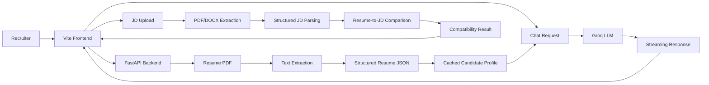

# AI Portfolio Assistant

AI-powered, recruiter-facing portfolio application built to help recruiters explore a candidate’s technical background, projects, internship experience, and role fit through interactive conversation and AI-driven compatibility analysis.

The project combines two major capabilities:

- An interactive AI portfolio chatbot that answers recruiter questions using structured candidate context.
- An AI-powered job description compatibility analyzer that compares a resume with a job description and identifies relevant fit, gaps, and strengths.

---

## Table of Contents

- [Project Overview](#project-overview)
- [Key Features](#key-features)
- [Technology Stack](#technology-stack)
- [System Architecture](#system-architecture)
- [Project Structure](#project-structure)
- [Installation and Local Setup](#installation-and-local-setup)
- [Environment Variables](#environment-variables)
- [API Endpoints](#api-endpoints)
- [Screenshots and Demo](#screenshots-and-demo)
- [Future Improvements](#future-improvements)
- [Deployment](#deployment)
- [Author](#author)

---

## Project Overview

This application is designed for recruiters, hiring managers, and technical evaluators who want a quick yet structured understanding of a candidate’s profile without manually reading a long resume.

The system supports several common recruiting workflows:

- Explore the candidate’s technical background, skills, and education.
- Ask questions about projects, internships, responsibilities, and engineering strengths.
- Ask follow-up questions in natural language and receive context-aware answers.
- Upload a job description in PDF or DOCX format.
- Receive an AI-generated compatibility assessment based on the candidate profile and the job description.
- Identify matching skills, missing requirements, relevant experience, project alignment, strengths, and areas for improvement.

The core objective is to make a candidate portfolio easier to evaluate for role fit while keeping responses grounded in the actual resume and job description content rather than generic AI responses.

---

## Key Features

### AI Portfolio Chatbot

- Context-aware conversational question answering.
- Uses a structured candidate profile generated from the resume as the primary source of truth.
- Maintains conversation history for follow-up questions and references.
- Uses JD and compatibility context when a job description has already been uploaded.
- Uses Groq-powered LLM responses for portfolio interaction.
- Streams responses token by token using Server-Sent Events (SSE).
- Renders markdown-formatted responses in the browser.
- Answers using documented candidate facts and only claims details supported by attributed information.

### Resume Processing

- Extracts text from the resume PDF using `pypdf`.
- Parses extracted resume content into a structured JSON profile using an LLM.
- Validates resume information using Pydantic models.
- Caches the parsed candidate profile to avoid reprocessing on repeated requests.

### Job Description Processing

- Accepts PDF and DOCX job description uploads.
- Extracts readable text from uploaded files.
- Parses the text into a structured JD profile.
- Captures fields such as job title, company, required skills, preferred skills, responsibilities, qualifications, and experience/education requirements when available.

### Compatibility Analyzer

- Compares the candidate profile against the parsed job description.
- Produces an overall compatibility score between 0 and 100.
- Highlights matching and missing skills.
- Evaluates relevance of preferred skills.
- Surfaces relevant internship experience and project evidence.
- Provides strengths, improvement areas, and a recommendation summary.
- Exposes results in a dedicated compatibility analysis view in the frontend.

---

## Technology Stack

### Frontend

- HTML
- CSS
- JavaScript
- Vite
- DOMPurify
- Marked

### Backend

- Python
- FastAPI
- Uvicorn
- Python-dotenv
- Pydantic
- Python multipart upload handling

### AI and LLM

- Groq API
- Groq model-based structured extraction and conversation generation
- JSON-based structured output validation via Pydantic models

### Document Processing and Utilities

- `pypdf` for resume and JD PDF extraction
- `python-docx` for DOCX job description extraction
- `python-multipart` for file uploads
- Git and GitHub for project version control

The backend is configured to use Groq models such as `openai/gpt-oss-20b` by default, with fallback model ordering implemented in the code when the primary model is unavailable or rate-limited.

---

## System Architecture

The app follows a simple client-server design:



### Implemented flows

1. Chat flow:
   - Frontend sends a chat request to the FastAPI backend.
   - The backend loads the candidate profile and optional JD/compatibility context.
   - The request is combined with conversation history and system instructions.
   - The Groq model generates a response.
   - The backend streams each AI delta as SSE data to the frontend.

2. JD analysis flow:
   - Recruiter uploads a PDF or DOCX job description from the frontend.
   - The backend extracts text from the file.
   - The parsed JD is converted into structured JSON.
   - The candidate profile and job description are compared using Groq-based analysis.
   - The compatibility result is returned to the frontend.

3. Resume flow:
   - The application reads the candidate resume PDF from the backend data directory.
   - Text is extracted from the PDF.
   - Resume data is converted into a structured profile using LLM extraction.
   - The parsed profile is cached in memory for reuse during chat and compatibility requests.

---

## Project Structure

```text
AI Portfolio Assistant/
├── README.md
├── .gitignore
├── backend/
│   ├── .env.example
│   ├── main.py
│   ├── portfolio.py
│   ├── requirements.txt
│   └── data/
│       └── Saran_S.pdf
├── frontend/
│   ├── index.html
│   ├── package.json
│   ├── script.js
│   ├── style.css
│   └── vite.config.js
└── .git/
```

### Important files and folders

- `frontend/`: Vite-based frontend UI for the portfolio assistant and JD analysis experience.
- `backend/`: FastAPI application, Groq logic, resume/JD parsing, and compatibility analysis.
- `backend/main.py`: Defines the FastAPI app, the health check route, the chat API route, and the JD analysis endpoint.
- `backend/portfolio.py`: Contains Groq client configuration, model fallback logic, resume parsing, JD parsing, compatibility analysis, and profile caching.
- `backend/data/`: Stores data files used by the application, including the candidate resume PDF.
- `frontend/index.html`: Main UI structure for the portfolio page, chat interface, and compatibility report layout.
- `frontend/script.js`: Browser logic for chat interactions, streaming display, markdown rendering, file upload, and compatibility result updates.
- `frontend/style.css`: Visual styling for the portfolio UI and report panels.
- `frontend/package.json`: Frontend dependencies and Vite scripts.
- `.gitignore`: Ignore rules for local environment and generated files.

> Sensitive files such as local environment variables and personal documents are not documented as part of the project tree and should remain excluded from Git as appropriate.

---

## Installation and Local Setup

### Prerequisites

- Python 3.10+
- `pip` or `uv`
- Node.js and npm
- Access to a Groq API key

### 1. Clone the repository

```bash
git clone <your-repository-url>
cd day9_personal_portfolio
```

### 2. Backend setup

The project uses a Python backend with a `requirements.txt` dependency list. The backend expects the environment file in the parent `Codes` directory, not inside the project folder, based on the code in `backend/portfolio.py`.

Create a virtual environment and install dependencies:

```bash
cd backend
python -m venv .venv
```

Activate it:

- macOS/Linux:

```bash
source .venv/bin/activate
```

- Windows PowerShell:

```powershell
.venv\Scripts\Activate.ps1
```

Install dependencies:

```bash
pip install -r requirements.txt
```

### 3. Configure environment variables

The backend reads the environment in the parent directory of the project:

- `D:/AI Engineer/Codes/.env` on this machine

Add your Groq credentials there:

```env
GROQ_API_KEY=your_groq_api_key
GROQ_MODEL=openai/gpt-oss-20b
```

The project also includes a template file at `backend/.env.example`.

### 4. Frontend setup

From the project root:

```bash
cd frontend
npm install
```

### 5. Run the backend

From `backend/`:

```bash
uvicorn main:app --host 127.0.0.1 --port 8000 --reload
```

The backend health check is available at:

```text
http://127.0.0.1:8000/health
```

### 6. Run the frontend

From `frontend/`:

```bash
npm run dev
```

The frontend dev server runs on:

```text
http://localhost:5173
```

---

## Environment Variables

The backend uses the following environment variables as implemented in the code.

| Variable | Required | Purpose |
| --- | --- | --- |
| `GROQ_API_KEY` | Yes | Used to authenticate Groq API calls for resume parsing, JD parsing, and chat generation. |
| `GROQ_MODEL` | Optional | Sets the preferred model used by the app. |
| `GROQ_MODELS` | Optional | Comma-separated list of alternative Groq model names used for fallback ordering. |

### Security note

API keys must never be committed to GitHub. Keep credentials in the local environment file outside the project directory or in a secure local secret management setup.

---

## API Endpoints

The FastAPI backend exposes the following routes.

### 1. Health check

| Method | Endpoint | Purpose |
| --- | --- | --- |
| `GET` | `/health` | Confirms the backend is running. |

Example response:

```json
{
  "status": "ok",
  "message": "Backend is running"
}
```

### 2. Portfolio chat

| Method | Endpoint | Purpose |
| --- | --- | --- |
| `POST` | `/chat` | Sends the conversation context to the Groq LLM and streams the response. |

Request body:

```json
{
  "messages": [
    { "role": "user", "content": "Tell me about his internship experience." }
  ],
  "job_description": { "job_title": "Software Engineer" },
  "compatibility": { "match_score": 85 }
}
```

Notes:

- `messages` is required and must be a list of objects containing `role` and `content`.
- `job_description` and `compatibility` are optional context objects.
- The response is streamed as Server-Sent Events (`text/event-stream`).
- Each chunk includes a JSON delta payload such as `{"delta": "some text"}` and the stream ends with `data: [DONE]`.

### 3. Job description analysis

| Method | Endpoint | Purpose |
| --- | --- | --- |
| `POST` | `/analyze-jd` | Uploads a PDF or DOCX job description and returns a compatibility analysis. |

Request:

- Multipart form upload with a file field named `file`
- Accepted file types: PDF and DOCX

Response:

```json
{
  "success": true,
  "filename": "job-description.pdf",
  "message": "JD successfully extracted, analyzed, and matched.",
  "job_description": { "job_title": "..." },
  "compatibility": { "match_score": 82 }
}
```

The compatibility payload includes structured fields such as:

- `match_score`
- `overall_assessment`
- `matching_skills`
- `missing_skills`
- `preferred_skills_matched`
- `relevant_experience`
- `relevant_projects`
- `strengths`
- `areas_to_improve`
- `recommendation`

---

## Screenshots and Demo

This section is reserved for screenshots and a demo walkthrough of the application experience.

Suggested placeholders:

- Screenshot 1: Portfolio chat interface
- Screenshot 2: JD upload workflow
- Screenshot 3: Compatibility analysis result panel
- Screenshot 4: Resume-driven chatbot response example

Add images to the repository or a docs folder when available.

---

## Future Improvements

The following are reasonable future enhancements and are not claimed as implemented features:

- Improved scoring transparency with more detailed reasoning traceability.
- Stronger prompt-injection and safety safeguards for recruiter queries.
- More extensive evaluation and testing for edge-case chat prompts.
- Additional deployment and monitoring configuration.
- Broader documentation of the portfolio dataset and analysis logic.
- Additional analytics for recruiter usage and feedback.

---

## Deployment

The application is a local project implementation and is not currently confirmed as deployed.

The intended architecture would be:

- Frontend: Vite app deployed to Vercel or a similar static hosting platform.
- Backend: FastAPI app deployed on Render, Railway, or another Python hosting platform.
- Environment variables: stored securely in the hosting provider environment, not in source control.
- Frontend API URL: configured to point to the deployed backend service.

These are deployment plans rather than completed deployment status.

---

## Author

**Saran S.**

Integrated M.Tech – Software Engineering  
Vellore Institute of Technology, Chennai  
2022–2027

---

## Summary

This project is a practical AI portfolio assistant that blends structured resume data, Groq-powered conversational AI, and resume-to-job compatibility analysis into a recruiter-friendly frontend experience. The implementation in this repository is focused on real, grounded interactions built around the candidate’s actual resume and uploaded job descriptions.
